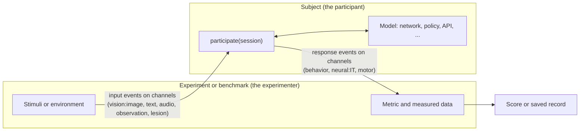

# What UMI is

## A lab for models

In a neuroscience or psychology lab, an experimenter presents stimuli to a participant, records what the participant does or what their neurons do, and compares those measurements across conditions or with other participants. The experimenter may also intervene, for example by silencing a brain area, and observe what changes.

UMI lets you do the same things with an artificial model as the participant. A model can be shown images, text, sounds or video, or placed in a game or robot task. Its answers and its internal activity can be recorded, and its units can be silenced or changed. The results can then be compared with data recorded from people and animals.

Classic Brain-Score asked one question per benchmark: how well does this model's activity or behavior match a fixed dataset? UMI keeps every classic benchmark and model, and adds the rest of the lab: any kind of input, closed-loop tasks, interventions, several regions or conditions in one run, and saved records that can be re-analyzed.

## The one diagram

Read it left to right:

1. The **experiment** (or a **benchmark**, which is an experiment with a fixed scoring rule) decides what to present.
2. Inputs travel as **events** on named **channels**, such as `vision:image` or `text`.
3. The **subject** is the participant. It receives the inputs through a **session** and responds. Inside, it may run a neural network, a robot policy, a remote API or a simple rule. The experiment does not need to know which.
4. Responses travel back as events on output channels, such as `behavior` (choices), `neural:IT` (activity standing in for brain area IT) or `motor` (actions).
5. The experiment compares the responses with measured data and produces a **score**, or saves everything for later analysis.

## Why it is built this way

**Every model is a subject, defined by what it declares.** A subject states which channels it can read and write. Whether two things fit together is decided from those declarations alone: a vision benchmark asking for `neural:IT` can run on any subject that reads `vision` and writes `neural:IT`, whether it is a CNN, a vision-language model or a video model. If a subject cannot provide what a benchmark needs, the pair is marked not applicable rather than scored zero.

**Parts compose.** A subject built with `BrainScoreModel` is assembled from interchangeable parts: an extractor per input type, a map from brain regions to layers, and optional parts for answers, actions and interventions. The same recording, intervention and experiment tools then work on any subject that exposes the needed parts. Something that works for an image model (for example, silencing units) works the same way for a language model or a robot policy.

**Nothing old is lost.** Existing Brain-Score vision and language models and benchmarks keep working through permanent adapters.

## Where to go next

- [Core concepts](02_core_concepts.md) defines each term in the diagram.
- [Lesson 1](../notebooks/lessons/01_your_first_subject.ipynb) builds a subject in about ten lines.
