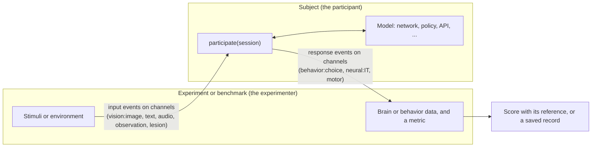

# What UMI is

## A common interface where experiments meet models

In a neuroscience or psychology experiment, an experimenter presents stimuli to a participant, records what the participant does or what their neurons do, and compares the measurements across conditions or participants. The experimenter may also intervene, for example by silencing a brain area, and observe what changes. The result is data: behavior and brain activity recorded from people and animals.

The Unified Model Interface (UMI, a working name) runs such an experiment with a model in the participant's place and compares what the model does with that data. A **benchmark** is an experiment together with its data and a metric. Its score says how close a model's answers, or the activity of the layers that stand for the brain regions the benchmark names, come to what was measured. A score is reported for each benchmark, next to a reference: a ceiling estimated from the data, or the scores of null models.

Two kinds of users meet here, and each one does their part once.

- **An experimenter** writes a procedure once: the stimuli, the task, the outputs to record, the data and the metric. The procedure then runs on every model that fits. That is a column of results, one for each model.
- **A modeler** adapts a model once, as a subject. The model then takes part in every experiment that fits. That is a row of results, one for each experiment.

Both work with the instruments of a lab: recording of answers and of internal activity, localizers that find units by how they respond, interventions that silence or change units and can be undone, and saved records that can be replayed and analyzed again. The induced dyslexia benchmark uses them on one question, what a model needs in order to read. It records a model's responses to words and pseudowords, finds the units that respond more to words, switches them off, and measures how the model's lexical decision changes on the stimuli of a reading study, with a lesion of the same size at random units as the control.

An experiment can also come from another library through an adapter, with its human data, and then runs on every subject that fits. And an experiment can be run on models alone, before any data from people exists. That is a way to find a hypothesis; it becomes a benchmark when the data exists.

Every Brain-Score vision and language benchmark and model keeps working. UMI widens what an experiment can be: any kind of input (images, text, sound, video), tasks in which the model acts in a game or a robot environment, interventions, several regions or conditions in one run, and records that are saved for a later analysis.

## The one diagram

Read it left to right:

1. The **experiment** (or a **benchmark**, which is an experiment with its data and a metric) decides what to present.
2. Inputs travel as **events** on named **channels**, such as `vision:image` or `text`.
3. The **subject** is the participant. It receives the inputs through a **session** and responds. Inside, it may run a neural network, a robot policy, a remote API or a simple rule. The experiment does not need to know which.
4. Responses travel back as events on output channels, such as `behavior:choice` (a choice), `neural:IT` (the activity of the layer that stands for brain area IT) or `motor` (actions).
5. The benchmark compares the responses with the measured data and gives a **score**. An experiment with no data yet saves everything for a later analysis.

## Why it is built this way

**Every model is a subject, defined by what it declares.** A subject states which channels it can read and write. Whether two things fit together is decided from those declarations alone: a vision benchmark asking for `neural:IT` can run on any subject that reads `vision:image` and writes `neural:IT`, whether it is a CNN, a vision-language model or a video model. If a subject cannot provide what a benchmark needs, the pair is marked not applicable rather than scored zero.

**Parts compose.** A subject built with `BrainScoreModel` is assembled from interchangeable parts: an extractor per input type, a map from brain regions to layers, and optional parts for answers, actions and interventions. The same recording, intervention and experiment tools then work on any subject that exposes the needed parts. Something that works for an image model (for example, silencing units) works the same way for a language model or a robot policy.

**Nothing old is lost.** Existing Brain-Score vision and language models and benchmarks keep working through permanent adapters.

## Where to go next

- [Core concepts](02_core_concepts.md) defines each term in the diagram.
- [Lesson 1](../notebooks/lessons/01_your_first_subject.ipynb) builds a subject in about ten lines.
