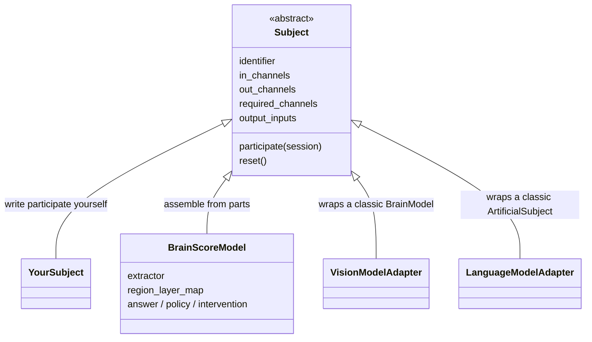
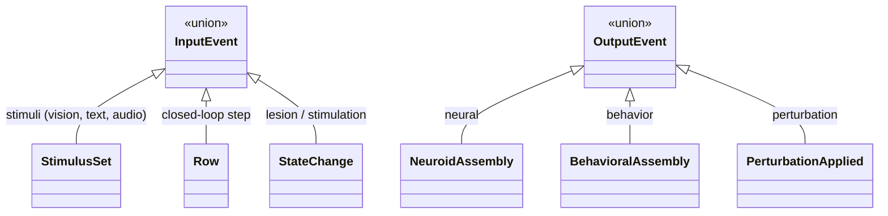
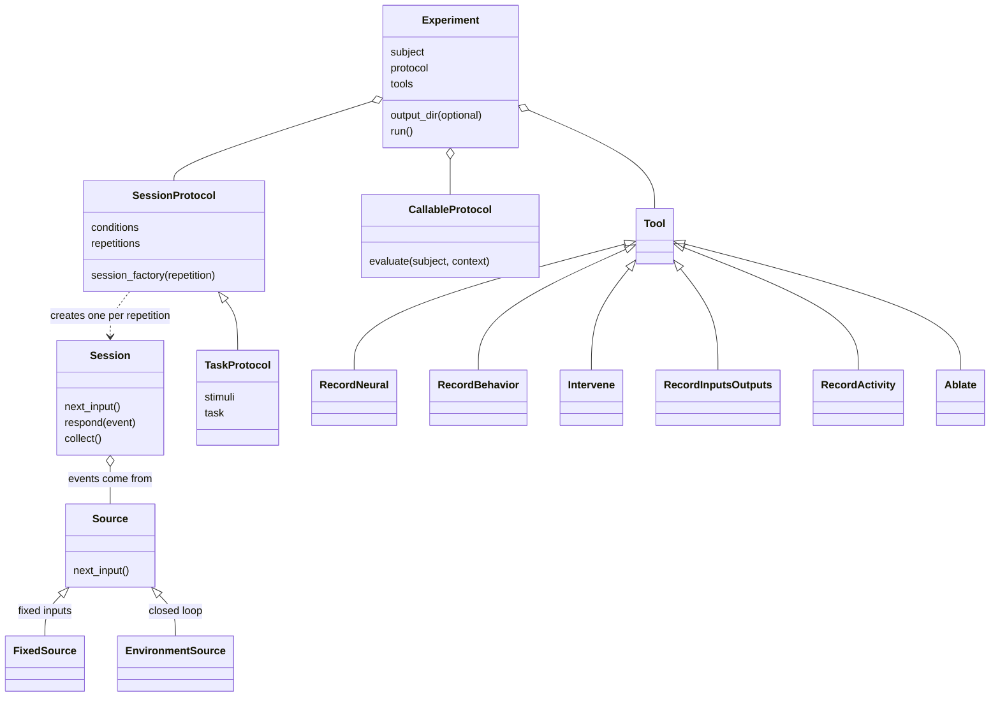

# Class map

This page connects the [core concepts](02_core_concepts.md) to the classes you write and the methods you call.

## Which method do I call?

| You want to | Call |
| --- | --- |
| Score a model on a benchmark | `brainscore.score(model, benchmark)` with objects or registered names |
| Run your own session on a subject | `subject.participate(session)` |
| Run a study with conditions, repetitions and tools | `Experiment(...).run()` |
| Record a region of a subject on some stimuli | `neural_response(subject, stimuli, ['neural:IT'])` |
| Try something quickly in a notebook on a `BrainScoreModel` | `model.process(...)` after `start_recording(...)` |

`participate(session)` is the only method the contract requires, and the only one benchmarks and experiments call. `process(...)` is a convenience that exists on `BrainScoreModel` and the legacy adapters; it does the same computation without a session. Use it interactively, but do not write benchmarks against it.

## Subjects



| Class | Choose it when | You provide |
| --- | --- | --- |
| `Subject` | Your system has its own loop: a remote API, a simulator agent, a hand-written rule. | `identifier`, channels, `participate` |
| `BrainScoreModel` | You have a network and want recording, behavior, intervention and closed-loop parts without writing a loop. | The parts below |
| `VisionModelAdapter`, `LanguageModelAdapter` | You have a classic Brain-Score model. `brainscore.load_model` applies these automatically. | Nothing |

## From an abstract part to a concrete class

Each `BrainScoreModel` part is a slot. Fill it with the class that matches your model.

### `extractor`: one per input type

| Your model's input | Use | Configure with |
| --- | --- | --- |
| Images (CNN, ViT) | `PytorchWrapper` | `preprocessing=` function |
| Images in a vision-language model with flattened patches (Qwen-VL, LLaVA) | `VLMVisionWrapper` | `processor=`, `layer_aggregation=` (`mean`, `first`, `sequence`) |
| Video clips (V-JEPA, VideoMAE) | `VideoWrapper`, keyed `'video'` | `preprocessing=`, `post_hook_fn=` |
| Video clips through a vision-language model (Qwen-VL) | `VLMVideoWrapper`, keyed `'video'` next to the image wrapper | the model's own processor |
| Text | `TextWrapper` | `tokenizer=`, `layer_aggregation=` (`last`, `mean`, `sequence`) |
| Audio | `AudioWrapper` | `processor=`, `layer_aggregation=` (`mean`, `sequence`) |
| Something else | Any callable `extractor(stimuli, layers=[...])` returning a `NeuroidAssembly` | |

```python
from brainscore_vision.model_helpers.activations.pytorch import PytorchWrapper
from brainscore.model_helpers.vlm_vision_wrapper import VLMVisionWrapper
from brainscore.model_helpers.video_wrapper import VideoWrapper
from brainscore.model_helpers.text_wrapper import TextWrapper
from brainscore.model_helpers.audio_wrapper import AudioWrapper
```

Each wrapper is named after what it wraps; pick the one for your model. A model with two towers, such as CLIP, gets two entries: `extractor={'vision': image_wrapper, 'text': text_wrapper}`.

A callable extractor returns one row per stimulus, in the order of `stimuli`, with `stimulus_id` on `presentation` and `neuroid_id` on `neuroid`:

```python
import numpy as np
import pandas as pd
from brainscore import BrainScoreModel
from brainscore_core.streaming_helpers import neural_response
from brainscore_core.supported_data_standards.brainio.assemblies import NeuroidAssembly
from brainscore_core.supported_data_standards.brainio.stimuli import StimulusSet


# Extractor: one unit, the sentence length
def word_lengths(stimuli, layers):
    values = np.array([[len(sentence)] for sentence in stimuli['sentence']], dtype=float)
    return NeuroidAssembly(values, dims=['presentation', 'neuroid'],
                           coords={'stimulus_id': ('presentation', list(stimuli['stimulus_id'])),
                                   'neuroid_id': ('neuroid', [f'{layers[0]}.0'])})


model = BrainScoreModel(identifier='word-length', extractor={'text': word_lengths},
                        region_layer_map={'language': 'length'})
# Record the region on two sentences
sentences = StimulusSet(pd.DataFrame({'stimulus_id': ['s0', 's1'], 'sentence': ['a cat', 'the zebra']}))
sentences.identifier = 'two-sentences'
print(neural_response(model, sentences, ['neural:language']).values.tolist())   # [[5.0], [9.0]]
```

A callable cannot list its layers, so it counts as having every layer. Next to another extractor, every region then names its input with `LayerSelector(name=..., modality=...)`.

### `region_layer_map` values

| Value | Means |
| --- | --- |
| `'layer4'` | Every unit of one layer (shorthand for `LayerSelector(name='layer4')`). |
| `LayerSelector(name=..., modality='text')` | One layer in a specific tower, when towers of two input families have a layer of that name. |
| `LayerSelector(name=..., modality=('text', 'vision'))` | The same, recorded by the text extractor, with the claim that pictures also reach the layer during an answer. |
| `CompositeSelector(layers=(('layer3', (0, 1)), ('layer4', None)))` | Units drawn from several layers. |

### Behavior, action and intervention parts

| Part | Signature | Ready-made builders |
| --- | --- | --- |
| `answer` | `(stimulus_row, instruction, label_set) -> text`, called with keywords | `api_answer` (hosted APIs) |
| `reply` | `prompt -> text` (or a `StreamEvent` with extra data) | `build_api_reply` (hosted APIs), `chat_parts` (Hugging Face chat models) |
| `likelihood` | `(prompt, candidates) -> {candidate: log probability}` | `chat_parts` |
| `policy` | `row -> {output channel: payload}`; keeps its own history and clears it in `reset()` | `api_policy` (hosted APIs), `DroidPolicy` (`brainscore.harnesses.droid_policy`), `LiberoChunkPolicy` (`brainscore.harnesses.libero_policy`) |
| `intervention` | `StateChange -> (PerturbationApplied, undo_function)` | `pytorch_intervention(net)` |
| `behavioral_readout_layer` | a layer path; to answer a choice, add `answer_owners={'behavior:choice': ('readout', 'argmax')}` | |

## Events



Each is carried as the `payload` of a `StreamEvent` on the matching channel. A closed-loop step is a **row**: a plain mapping of channel to payload. A policy answers with a mapping of output channel to payload, such as `{'motor': action}`.

## Sessions, protocols and experiments



`TaskProtocol` presents a stimulus set under a task, once per repetition, and requests whatever the attached recorders ask for. `SessionProtocol` builds a fresh session for each repetition from your own factory. `CallableProtocol` wraps an evaluator that already exists, such as a classic benchmark or a robotics evaluator, and keeps its own loop.

## Where to import from

| Names | Module |
| --- | --- |
| `Subject`, `TaskContext`, `Benchmark`, `Score`, `Selection`, `StateChange`, `Perturbation`, `check_compatibility` | `brainscore_core` |
| `StreamEvent`, `Session`, `FixedSource` | `brainscore_core.streaming` |
| `run_environment`, `neural_response`, `apply_state_change` | `brainscore_core.streaming_helpers` |
| `score`, `load_model`, `load_benchmark`, `BrainScoreModel`, `LayerSelector`, `CompositeSelector`, `IndexSelection`, `RandomSelection`, `FunctionalSelection` | `brainscore` |
| `PytorchWrapper` | `brainscore_vision.model_helpers.activations.pytorch` |
| The other wrappers | `brainscore.model_helpers.<name>_wrapper` |
| `Experiment`, protocols, tools, replay | `brainscore.experiments` |
| `RunRecord` | `brainscore.run_record` |
