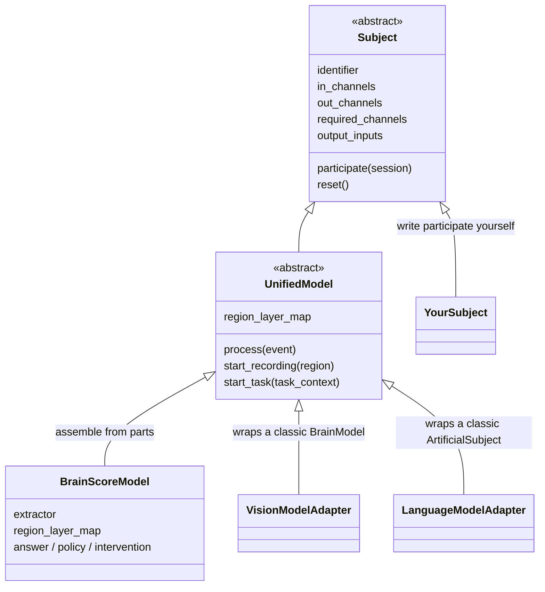
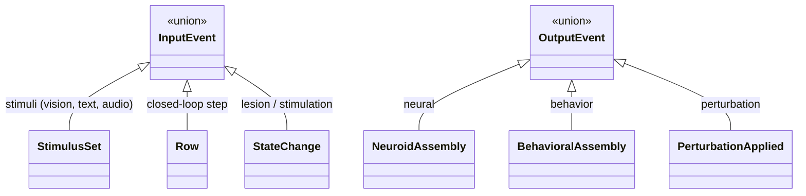
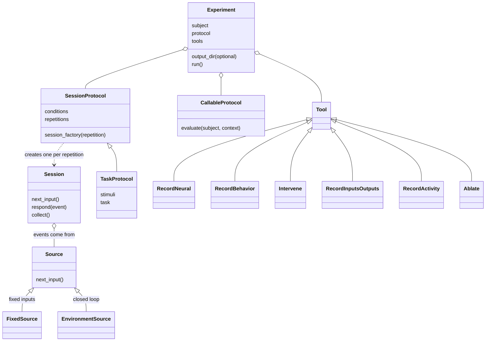

# Class map

This page connects the [core concepts](02_core_concepts.md) to the classes you write and the methods you call.

## Which method do I call?

| You want to | Call |
| --- | --- |
| Score a model on a benchmark | `brainscore.score(model, benchmark)` with objects or registered names |
| Run your own session on a subject | `subject.participate(session)` |
| Run a study with conditions, repetitions and tools | `Experiment(...).run()` |
| Try something quickly in a notebook on a `BrainScoreModel` | `model.process(...)` after `start_recording(...)` or `start_task(...)` |

`participate(session)` is the only method the contract requires, and the only one benchmarks and experiments call. `process(...)` is a convenience that exists on `BrainScoreModel` and the legacy adapters; it does the same computation without a session. Use it interactively, but do not write benchmarks against it.

## Subjects



| Class | Choose it when | You provide |
| --- | --- | --- |
| `Subject` | Your system has its own loop: a remote API, a simulator agent, a hand-written rule. | `identifier`, channels, `participate` |
| `BrainScoreModel` | You have a network and want recording, behavior, perturbation and closed-loop parts without writing a loop. | The parts below |
| `VisionModelAdapter`, `LanguageModelAdapter` | You have a classic Brain-Score model. `brainscore.load_model` applies these automatically. | Nothing |
| `UnifiedModel` | Rarely. It is the shared base of the classes above. | |

## From an abstract part to a concrete class

Each `BrainScoreModel` part is a slot. Fill it with the class that matches your model.

### `extractor`: one per input type

| Your model's input | Use | Configure with |
| --- | --- | --- |
| Images (CNN, ViT) | `VisionWrapper(kind='frame')` | `preprocessing=` function |
| Images in a vision-language model with flattened patches (Qwen-VL, LLaVA) | `VisionWrapper(kind='vlm')` | `processor=`, `layer_aggregation=` |
| Video clips (V-JEPA, VideoMAE) | `VisionWrapper(kind='temporal')`, keyed `'video'` | `preprocessing=`, `post_hook_fn=` |
| Video clips through a vision-language model (Qwen-VL) | `VLMVideoWrapper`, keyed `'video'` next to the image wrapper | the model's own processor |
| Text | `TextWrapper` | `tokenizer=`, `layer_aggregation=` (`last_token`, `mean_tokens`, `per_token`) |
| Audio | `AudioWrapper` | `processor=`, `layer_aggregation=` (`mean_time`, `time_series`) |
| Something else | Any callable `extractor(stimuli, layers=[...])` returning a `NeuroidAssembly` | |

```python
from brainscore.model_helpers.vision_wrapper import VisionWrapper
from brainscore.model_helpers.text_wrapper import TextWrapper
from brainscore.model_helpers.audio_wrapper import AudioWrapper
```

`kind` is inferred when omitted; check `wrapper.kind`. A model with two towers, such as CLIP, gets two entries: `extractor={'vision': image_wrapper, 'text': text_wrapper}`.

### `region_layer_map` values

| Value | Means |
| --- | --- |
| `'layer4'` | Every unit of one layer (shorthand for `LayerSelector(name='layer4')`). |
| `LayerSelector(name=..., modality='text')` | One layer in a specific tower of a multi-tower model. |
| `CompositeSelector(layers=(('layer3', (0, 1)), ('layer4', None)))` | Units drawn from several layers. |

### Behavior, action and intervention parts

| Part | Signature | Ready-made builders |
| --- | --- | --- |
| `answer` | `(stimulus_row, instruction, label_set) -> label` | `build_api_generation_fn` (hosted APIs) |
| `policy` | `row -> {output channel: payload}` | `PolicyWrapper` |
| `intervention` | `StateChange -> (PerturbationApplied, undo_function)` | `build_pytorch_ablation_fn(net)` |
| `behavioral_readout_layer` | a layer path | |

## Events



Each is carried as the `payload` of a `StreamEvent` on the matching channel. A closed-loop step is a **row**: a plain mapping of channel to payload. A policy answers with a mapping of output channel to payload, such as `{'motor': action}`.

## Sessions, protocols and experiments



`TaskProtocol` presents a stimulus set under a task, once per repetition, and requests whatever the attached recorders ask for. `SessionProtocol` builds a fresh session for each repetition from your own factory. `CallableProtocol` wraps an evaluator that already exists, such as a classic benchmark or a robotics evaluator, and keeps its own loop.

## Where to import from

| Names | Module |
| --- | --- |
| `Subject`, `BrainScoreModel`, `TaskContext`, `Benchmark`, `Score`, selections, events, `check_compatibility` | `brainscore_core` |
| `StreamEvent`, `Session`, `FixedSource` | `brainscore_core.streaming` |
| `run_environment`, `neural_response`, `apply_state_change` | `brainscore_core.streaming_helpers` |
| `score`, `load_model`, `load_benchmark` | `brainscore` |
| Wrappers | `brainscore.model_helpers.<name>_wrapper` |
| `Experiment`, protocols, tools, replay | `brainscore.experiments` |
