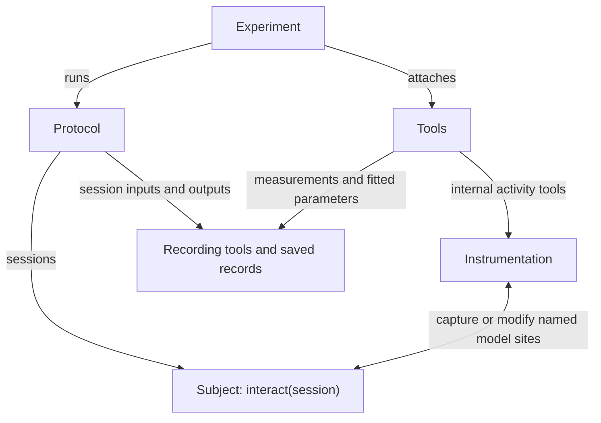

# Instrumentation, tools and experiments

**Instrumentation provides access to the model. Tools choose what to measure or
change. An experiment runs a procedure with those tools attached.**

| Part | Owns | Example |
| --- | --- | --- |
| **Instrumentation** | Backend-specific access to explicitly named model sites; capturing activity and installing/removing intervention hooks. | `TorchInstrumentation({"language": module})` |
| **Tool** | A configured measurement or intervention, its fitted parameters when needed, and emitted measurements. | An activity recorder, linear probe, LEACE eraser or steering direction. |
| **Protocol** | The procedure: inputs, conditions, trials, session progression and reset rules. | Compare baseline, erased and restored conditions. |
| **Experiment** | Connects the subject, protocol, tools and output directory; validates the setup and manages tool scopes and run records. | `Experiment(subject=..., protocol=..., tools=..., instrumentation=...)` |

The diagram shows responsibilities, not an extra evaluation path. The subject
still evaluates through `interact(session)`. Instrumentation is supplied
explicitly; it does not discover private models or add subject methods.

## Example: erase information and measure the result

The **protocol** supplies the stimuli and baseline/erased/restored conditions.
The **LEACE tool** holds an erasure map fitted earlier on discovery activity,
and selects the erased condition. The **instrumentation** applies that map at
the named site and removes its hooks when the scope closes. The **experiment**
runs the protocol with the tools attached. Two probe tools can measure activity
before and after erasure in the same forward pass; `record-io` saves their
measurements with the condition and trial context.

The experiment opens and closes tool scopes; instrumentation owns the actual
hooks. This keeps cleanup tied to the operation that installed them, including
on failure. Within a tool collection, observers come first, then before
measurements, interventions and after measurements. List order applies within
each phase.

## Use only the pieces you need

- **Offline:** fit or apply a probe, eraser or steering map to saved assemblies.
  No instrumentation or experiment is needed.
- **Existing procedure:** use `attach_tools(...)` around caller-owned sessions
  or a benchmark. It reuses experiment validation and tool scopes; the caller
  retains execution and reset ownership.
- **Complete run:** use `Experiment` with a protocol to manage trials, conditions
  and tool lifetimes together.

Event tools such as input/output and exposed reasoning recorders do not need
internal model instrumentation. `SessionProtocol` supplies session events;
direct attachment records tool events and does not automatically intercept
session inputs/outputs. Each backend supports an explicit set of operations.

See the [tool catalog](tools.md) for loading and composition, or
[set up an experiment](experiment_toolbox.md) for runnable patterns.
